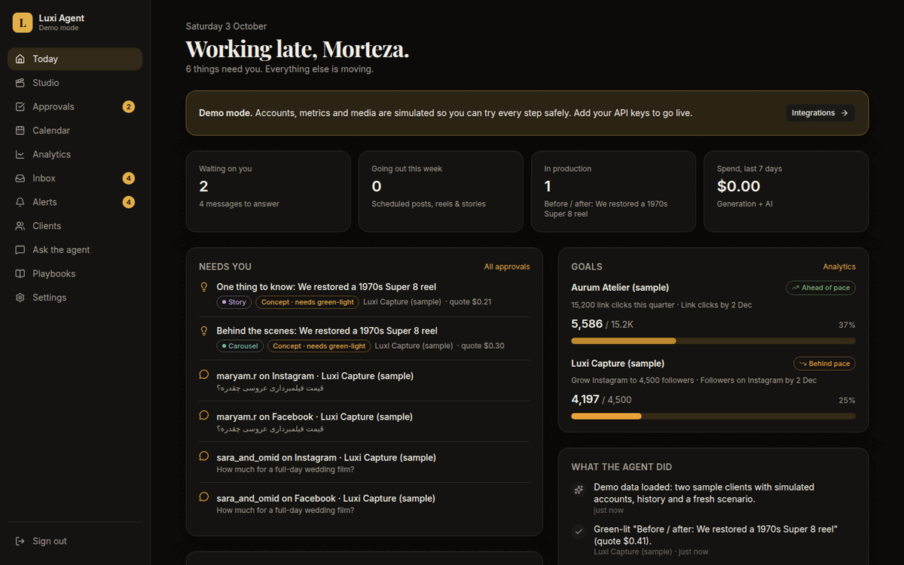
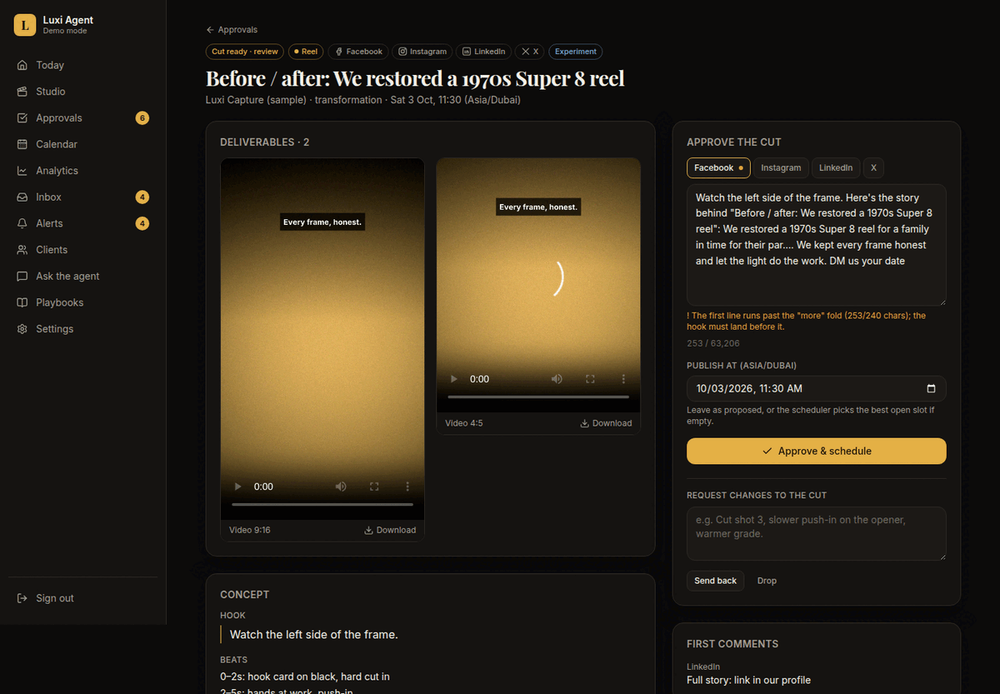

# Luxi Social Agent

An AI social media team for an agency. Give it a client, their accounts and a goal. Then describe what's
happening — a shoot, a launch, a story — and it plans the content, writes captions for each platform,
produces images and motion video, and sends everything to you for approval. Once you approve, it
schedules and publishes, measures what happens, answers comments and DMs, and keeps changing the
content until the goal is met. Every morning it checks the platforms and tools for changes and tells
you what matters.

It runs as one web app you install on your phone and desktop (a PWA), with the agent working in the
background on the server.

<p>
  
  
</p>

## What it does

| You asked for | How it works |
|---|---|
| **Connect Meta (Instagram + Facebook), LinkedIn and X** | Per-client OAuth connect for Instagram Professional accounts and Facebook Pages (Meta Graph API), LinkedIn company pages (Community Management API) and X (API v2). Tokens are encrypted at rest and refreshed automatically. Optional **Metricool route** per platform while app reviews are pending. |
| **Create content from my scenario** | In the **Studio** you describe the scenario. The strategist weighs at least five angles (transformation, behind the scenes, POV, myth vs reality…) against the client's goal, brief, past results and running experiments. It then writes concepts, each with a hook, timed beats, rationale, story frames and a full production plan. A critic scores every concept, and weak ones are rewritten. |
| **Schedule for date and time** | Each concept gets a slot in the client's time zone, taken from proven defaults and then from hours learned from their own data. It respects pacing rules (max one reel per day per platform, feed posts at least 4 h apart, stories at least 2 h apart). You can override the time when you approve. |
| **Sort by story, reel, post** | Format drives everything: 9:16 reels, stories with sticker plans, feed posts and carousels (also as LinkedIn PDF documents). The calendar colour-codes them, and Analytics compares them. |
| **Different captions per platform** | Every concept carries four captions, each checked against its platform's rules: Instagram 125-character fold and at most 5 hashtags, Facebook fold, LinkedIn link in the first comment, X 280 weighted characters. A cliché filter runs on all of them. Captions that break a rule are rewritten automatically. You edit them with the same checks running live. |
| **Monitor engagement, impressions, audience, age, clicks** | Post metrics are collected 6 h, 24 h, 72 h and 7 days after publishing. Account KPIs are collected daily, along with audience breakdowns (age, gender, cities and countries; LinkedIn seniority, industry and job function), clicks and profile visits. A funnel diagnosis shows where posts lose people: distribution, hook, resonance or conversion. |
| **Follow the goal I set and pivot until it's hit** | You set one measurable goal per client (followers, reach, link clicks, leads…). The agent paces against it daily. When the goal falls behind, or at the weekly review, it diagnoses the bottleneck and starts one controlled experiment a week. Small adjustments (times, hashtags, hooks) are applied automatically, and planned concepts are re-planned around the pivot. Learnings become insights it reads before every plan. |
| **Prepare everything, make the motion video, send for approval, then schedule** | Two gates. First you **green-light** a concept and its quote, so nothing is spent before you agree. Production then generates stills and video with **Higgsfield** and voice, music and sound effects with **ElevenLabs**, and cuts it all into a cinematic edit with ffmpeg: camera moves, transitions, typography, word-synced captions (Farsi too), music ducking and loudness. Each platform gets its own aspect ratio. Second, you **approve the cut** with its final captions and time, and only then is it scheduled. |
| **Daily self-update check** | Every morning the agent reads the Meta, Instagram, LinkedIn and X changelogs and the ElevenLabs and Higgsfield docs. It also checks every client account's health, publishing failures and credits. Important changes are pushed to your phone; the rest wait in Alerts. When a change affects how content should be made, it proposes an edit to its own playbook for you to approve. |
| **Answer messages and reply to comments** | Comments and DMs are answered in the client's voice and the commenter's language. Spam is hidden. Complaints, legal, press and safety issues get a short holding reply and come to you. Leads asking about prices or bookings get a warm reply, never a price, and are flagged for your personal follow-up. Each client can be set to auto-reply, draft only, or off. |
| **Install on phone and desktop** | Installable PWA for iPhone, Android, Mac and Windows, with push notifications for approvals, alerts and the morning brief. Phones get a bottom tab bar, desktops a sidebar. Telegram is optional. |
| **Use Higgsfield, ElevenLabs and anything that helps quality** | Higgsfield for images and video (the endpoint for each role is editable in Settings), ElevenLabs `eleven_v3` voice with timestamps, music and sound effects, ffmpeg for the edit, and Claude for every decision and every word. |

You can also **ask the agent** anything in chat — "what's waiting on me?", "why did last week dip?",
"plan three reels for the launch" — and it looks things up or acts through the same tools.

## Try it in two minutes (demo mode)

Requirements: Node.js 22+ and ffmpeg (`brew install ffmpeg` / `apt install ffmpeg`).

```bash
npm install
npm run dev
```

Open http://localhost:3000 and sign in with the development login shown on the sign-in page. On
**Today**, click **Load sample data**. You get two sample clients with simulated accounts, 45 days of
history, published posts with metrics, goals with real pacing, answered comments and a fresh scenario.
One concept is already green-lit, so within a minute a real rendered cut appears in **Approvals**.
Approve it and watch it get scheduled.

Without API keys everything runs in **demo mode**: simulated accounts and metrics, placeholder
visuals and sound, and a rule-based stand-in for Claude. Every screen and every step works, and
nothing is posted anywhere.

## Going live

1. Copy `.env.example` to `.env`. Set `APP_URL` to your public HTTPS address, plus
   `SESSION_SECRET`, `ENCRYPTION_KEY`, `ADMIN_EMAIL` and `ADMIN_PASSWORD_HASH`
   (`npm run hash-password -- 'your password'`).
2. Add `ANTHROPIC_API_KEY`. Demo mode turns off and the real agent takes over.
3. Add `HIGGSFIELD_CREDENTIALS` and `ELEVENLABS_API_KEY` for production.
4. Create the Meta, LinkedIn and X developer apps and add their keys. Then open a client →
   **Accounts** → **Connect**.
5. Run `npm run vapid`, add the keys and enable notifications on each device.

**[docs/SETUP.md](docs/SETUP.md)** walks through every step: app permissions, webhooks, storage,
deployment and security.

## Install on your phone and computer

The app must be served over HTTPS (localhost is fine for testing).

- **iPhone / iPad:** open the app in Safari → Share → **Add to Home Screen**. Open it from the Home
  Screen, then **Settings → Enable notifications on this device** (iOS 16.4+).
- **Android:** open in Chrome → **Install app** (or the menu → Install). Then enable notifications in Settings.
- **Mac / Windows:** open in Chrome or Edge → the install icon in the address bar. Then enable notifications in Settings.

## Deploy

**Docker Compose** (recommended): the app (web, agent worker and renderer) plus Postgres.

```bash
cp .env.example .env    # fill it in
docker compose up -d
```

Put it behind HTTPS, for example with Caddy, Cloudflare Tunnel or your host's proxy. Rendered media
lives in the `media` volume and the database in `pg`.

**Any Node host:** `npm ci && npm run build && npm start`. The worker runs inside the web
process (`RUN_WORKER=in-process`). Without `DATABASE_URL` it uses an embedded PGlite database in
`DATA_DIR`, which is fine for one instance. Use Postgres to run `npm run worker` as a separate
process.

**Serverless:** set `RUN_WORKER=off` and call `GET /api/cron/tick` every minute with
`Authorization: Bearer $CRON_SECRET`. You need Postgres and S3-compatible storage. Video rendering
needs ffmpeg and minutes of CPU, so a small always-on server is usually the better fit.

## How it's built

```
Next.js 16 app (React 19, Tailwind 4)            the PWA, API routes, server actions
  └─ in-process worker ── job queue + cron (Postgres or embedded PGlite, Drizzle ORM)
       ├─ agent (Claude)  strategist · critic · copy fixer · director · analyst · community · watcher · chat
       ├─ generation      Higgsfield (images, video) · ElevenLabs (voice, music, SFX)
       ├─ renderer        ffmpeg + libass: motion, transitions, typography, captions, mix, aspect variants
       └─ platforms       Meta Graph · LinkedIn REST · X v2 · Metricool · demo adapter
```

The content lifecycle is a state machine: `concept → greenlit → producing → review → approved →
scheduled → live → analyzed`. The two human gates are enforced in code, not just in the UI.
[docs/AGENT.md](docs/AGENT.md) explains how the agent decides, measures and pivots, and where to tune it.

The agent's working knowledge lives in five editable **playbooks** (creative, platforms,
strategy, community, watch). Edit them in the app under **Playbooks**; the agent reads them before
every plan, reply and review.

## Scripts

| Command | What it does |
|---|---|
| `npm run dev` | Development server (worker included) |
| `npm run build` / `npm start` | Production build / server |
| `npm test` | Test suite (unit, platform adapters with mocked APIs, real ffmpeg renders, full demo-mode pipeline) |
| `npm run typecheck` | TypeScript check |
| `npm run worker` | Standalone worker process (needs `DATABASE_URL`; set `RUN_WORKER=off` on the web app) |
| `npm run agent -- <job>` | Run one routine now, e.g. `npm run agent -- watch.daily` |
| `npm run seed:demo` | Load the sample data from the command line (stop the app first when using PGlite) |
| `npm run db:migrate` | Apply database migrations (also applied automatically on start) |
| `npm run vapid` | Generate Web Push keys |
| `npm run hash-password -- '…'` | Generate `ADMIN_PASSWORD_HASH` |

## Project layout

```
src/app/           screens (Today, Studio, Approvals, Calendar, Analytics, Inbox, Alerts, Clients, Chat, Playbooks, Settings) and API routes
src/agent/         Claude roles, prompts, structured outputs, chat tools, demo stand-ins
src/domain/        pure rules: lifecycle, captions, scheduling, analytics & pacing, quotes, time zones, cron
src/server/        database, job queue, pipeline, platform adapters, generation, media renderer, notifications, auth
playbooks/         the agent's editable knowledge (seeded into the database)
assets/fonts/      bundled typefaces for the renderer (OFL licensed, including Vazirmatn for Farsi)
tests/             vitest suites
docs/              setup and agent guides
```

## Things to know

- **Higgsfield's API evolves quickly.** The model registry (Settings → Generation models) maps each
  role (cinematic video, fast video, hero still…) to an endpoint and its input fields. The defaults
  follow Higgsfield's published API, but check them against your account on the first real render
  and adjust there without touching code.
- **Story stickers** (polls, questions, links) can't be added through any API. The agent prepares
  the frames and the sticker plan, marks the story "post by hand", and tracks it once you tap
  **Mark as posted**.
- **Meta and LinkedIn publishing permissions** need app setup and, for accounts you don't manage
  yourself, app review. Until then, route a platform through Metricool from the client page.
- **AI disclosure:** posts with AI-generated visuals published through the direct APIs get a short
  disclosure line ("AI-assisted visuals.", editable or switchable per client), because native AI
  labels can't be set through the APIs.
- **Costs:** the quote for each piece is computed from the price table in Settings before you
  green-light it. Production stops and asks again if real costs run more than 15% over the quote.
  Claude usage is tracked per task under Settings → Usage.
- One owner login. The app is built for you to run the agency; client logins aren't included.
